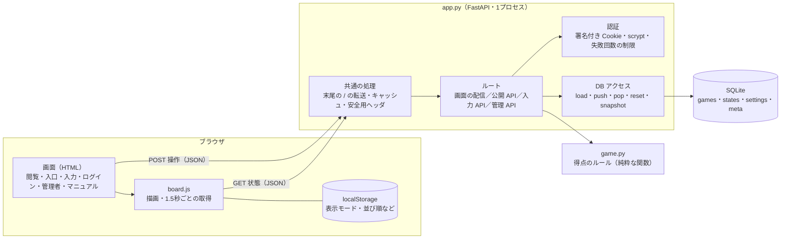
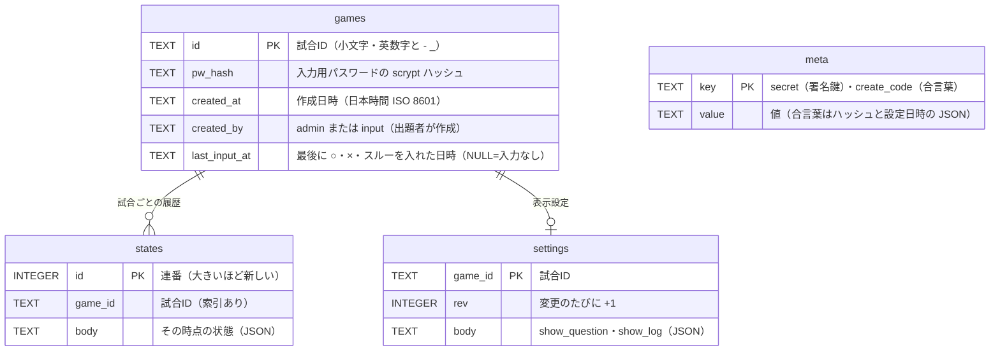
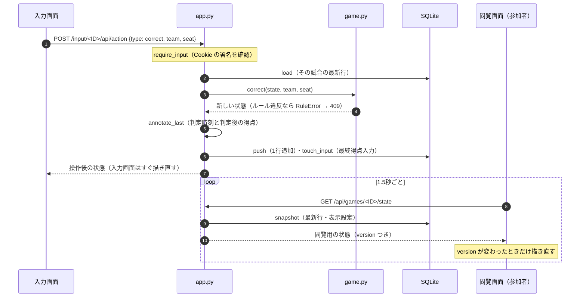
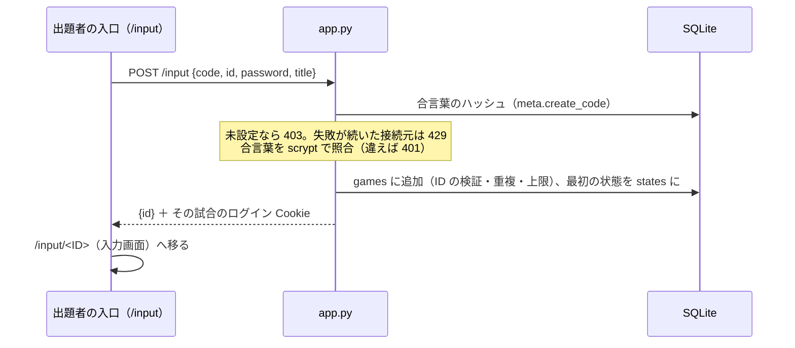

# アプリケーション構成とデータ構造

aql-scoreboard（AQL の2チーム戦の正誤入力・得点表示）の作りを説明する。使い方は `static/manual.html`（本番では `/score/manual`）、運用と設定は `README.md`、負荷試験は `docs/nonfunctional-test.md` を見る。

## 1. 概要

- 出題者が入力画面で ○・×・スルーを入れ、参加者が閲覧画面で得点・リーチ・封鎖を見る。
- 複数の部屋の試合を同時に扱う。試合は「試合ID」で分け、試合ごとに入力用パスワードを持つ。
- サーバーは Python（FastAPI）の1プロセスで、データは SQLite の1ファイル。
- 画面はビルド工程のない素の HTML・CSS・JavaScript で、1.5秒ごとに状態を取得して描き直す（WebSocket は使わない）。
- 本番では前に CloudFront と nginx が立ち、`/score` の下で動く。画面は相対パスで書いてあるので、前に付くパスを問わない。

## 2. 技術スタック

| 層 | 使っているもの | 補足 |
|---|---|---|
| 言語 | Python 3.12（3.11 以上） | |
| Web フレームワーク | FastAPI 0.142 / Starlette 1.7 / Pydantic 2.13 | `docs`・`openapi` は無効 |
| アプリサーバー | uvicorn 0.54（`[standard]`） | 書き込みを1プロセスに集めるため worker は1つ |
| データベース | SQLite（標準ライブラリの `sqlite3`） | ファイル1つ。ORM は使わない |
| 認証 | 標準ライブラリの `hashlib.scrypt`・`hmac`・`secrets` | 外部の認証基盤は使わない |
| 画面 | HTML・CSS・JavaScript（フレームワーク・ビルドなし） | 1.5秒ごとのポーリング |
| 同梱ライブラリ | html-to-image 1.11.13（画像をコピー）、qrcode-generator 2.0.4（QR コード） | どちらも MIT。`static/vendor/` に同梱し、npm の sha512 を照合済み |
| フォント | Google Fonts の BIZ UDPGothic・Saira Extra Condensed・Noto Sans JP、同梱の Inter（OFL） | BIZ UDPGothic・Saira は SportsManiax、Inter・Noto Sans JP は J.League の表示モードで使う |
| テスト | pytest ＋ FastAPI の TestClient（httpx） | `uv run pytest` |
| パッケージ管理 | uv（`pyproject.toml`・`uv.lock`） | |
| 実行環境 | Docker（`python:3.12-slim`） | 本番は版を固定してインストール |
| 前段（本番） | CloudFront → nginx（コンテナ） | aql-sokuhou と同じ EC2 に同居 |

## 3. ディレクトリ構成

```
aql-scoreboard/
├── app.py              サーバー全体（DB・認証・画面の配信・API・共通の処理）
├── game.py             得点のルール（状態 dict を受け取り、新しい dict を返す純粋な関数）
├── static/
│   ├── board.js        閲覧・入力で共用：描画、ポーリング、表示モード、並び順、画像化、QR
│   ├── board.css       共通の見た目（ライト・ダーク・SportsManiax・J.League の4モード）
│   ├── viewer.html     閲覧画面            /<ID>
│   ├── input.html      入力画面            /input/<ID>
│   ├── input.css       入力画面の見た目
│   ├── input_entry.html 出題者の入口        /input
│   ├── index.html      試合IDの入力欄       /
│   ├── login.html      ログイン（入力・管理者で共用）
│   ├── admin.html      管理者画面          /admin
│   ├── manual.html     マニュアル          /manual
│   ├── notfound.html   試合が見つかりません
│   ├── pages.css       入口・ログイン・管理者・マニュアルの見た目
│   └── vendor/         html-to-image・qrcode-generator・Inter（inter/）とライセンス
├── tests/              test_game.py（ルール）、test_app.py（API・画面・認証）
├── tools/              make_qr_pdf.py（QR の PDF）、loadtest.py（負荷試験）
├── docs/               この文書、非機能試験の記録
├── Dockerfile
└── pyproject.toml / uv.lock
```

## 4. 全体の構成



## 5. コンポーネント

### 5.1 サーバー（app.py）

| 部分 | 主な関数 | 役割 |
|---|---|---|
| DB の準備 | `_conn` | 表を作る。古い形の DB を移行する（1試合版の表を `legacy_*` へ、列 `created_by`・`last_input_at` の追加） |
| 試合の状態 | `load`・`push`・`pop`・`reset`・`snapshot` | 状態の読み書き。取り消しは最新行の削除。`snapshot` は画面向けの JSON を作り、閲覧用では表示 OFF の項目を外す |
| 表示設定 | `load_display`・`save_display` | 閲覧画面に問題数・判定の記録を出すか（試合ごと。取り消し・リセットの対象外） |
| 試合の管理 | `create_game`・`delete_game`・`list_games` | 作成（ID の検証・上限）・削除・一覧（最終得点入力などを含む） |
| 作成用の合言葉 | `create_code`・`set_create_code`・`code_status` | 出題者が試合を作るための合言葉（ハッシュだけを保存） |
| 認証 | `hash_password`・`verify_password`・`make_token`・`check_token`・`require_input`・`require_admin` | パスワードのハッシュ、署名付きトークン、FastAPI の依存関数 |
| 失敗回数の制限 | `client_ip`・`_throttle`・`_failed`・`_succeeded` | 「対象 × 接続元 IP」ごとに数え、5回続けて失敗したら30秒止める（メモリ上） |
| 画面の配信 | `page` | HTML の `{{STATIC}}` を、ページの深さに合わせた相対パスに置き換えて返す |
| 共通の処理 | `trailing_slash`・`no_cache` | 末尾の `/` を相対パスで転送。`Cache-Control: no-cache` と安全用ヘッダを付ける |
| 操作 | `act`・`annotate_last`・`touch_input` | 操作の種類ごとに `game.py` を呼んで保存。判定には時刻と判定後の得点を付け、最終得点入力を更新 |
| 試合記録 | `export_record` | 試合記録（JSON）を作る |

### 5.2 得点のルール（game.py）

状態 dict を受け取り、新しい dict を返す（元の dict は変えない）。DB や HTTP には触れない。

| 関数 | 役割 |
|---|---|
| `new_state` | 最初の状態（チーム名・参加者名・空席・試合名・勝利点などを引き継げる） |
| `correct`・`wrong`・`through` | ○・×・スルー。誤答は枠の得点を1に戻して × を足し、×2で封鎖。相手の封鎖枠は ×1 に戻す |
| `rename`・`set_roster`・`set_targets`・`set_question_limit` | 試合名・チーム名、参加者名と空席、勝利点、40問で終了しない |
| `product`・`team_score`・`is_reach`・`is_locked`・`is_vacant` | 得点（積・勝利点で頭打ち）、リーチ・封鎖・空席の判定 |
| `result` | 勝敗（勝利点到達・全枠封鎖・規定問題数終了） |
| `last_judged` | 直前の ○・× の枠（強調表示用） |
| `view` | 表示用に得点・リーチ・封鎖・勝敗・直前の判定を足した dict |

### 5.3 画面（static/）

| 画面 | URL | 主な部品 | データの取り方 |
|---|---|---|---|
| 試合IDの入力欄 | `/` | `index.html` | なし（`/<ID>` へ移る） |
| 閲覧画面 | `/<ID>` | `viewer.html` ＋ `board.js` | `GET /api/games/<ID>/state` を1.5秒ごと |
| 出題者の入口 | `/input` | `input_entry.html` | `POST /input`（作成） |
| 入力画面 | `/input/<ID>` | `input.html` ＋ `board.js` | `GET /input/<ID>/api/state` を1.5秒ごと、`POST …/api/action` |
| ログイン | `/input/<ID>`・`/admin`（未ログイン時） | `login.html` | `POST …/login` |
| 管理者画面 | `/admin` | `admin.html` | `GET /admin/api/games` を5秒ごと |
| マニュアル | `/manual` | `manual.html` | なし |

`board.js` の主な役割:
- `render`: 両チームの枠・得点・勝敗・判定の記録を描く。リーチ・封鎖・空席・直前の判定の見た目もここで付ける。
- `poll`: 一定間隔で状態を取り、版（`version`）が変わったときだけ描き直す。401・404 のときは呼び出し元に知らせる。
- `bindTheme`・`bindLayout`: 表示モードと並び順（左右入れ替え・枠を5→1）を端末に保存する。
- `bindShot`・`shotStage`: 得点状況を画像にしてコピーする（html-to-image）。
- `showQr`: 閲覧画面の URL の QR コードを出す（qrcode-generator）。

## 6. API

| メソッド | パス | 認証 | 内容 |
|---|---|---|---|
| GET | `/api/games/<ID>/state` | なし | 閲覧用の状態。表示 OFF の項目（問題数・判定の記録）は含めない |
| POST | `/input` | 作成用の合言葉 | 試合を作り、その試合にログインした状態にする |
| POST | `/input/<ID>/login`・`/logout` | 入力用パスワード | ログイン・ログアウト |
| GET | `/input/<ID>/api/state` | 入力 | 入力用の状態（すべての項目） |
| POST | `/input/<ID>/api/action` | 入力 | 操作（下の表）。応答は操作後の入力用の状態 |
| GET | `/input/<ID>/api/export` | 入力 | 試合記録（JSON ファイル） |
| POST | `/admin/login`・`/logout` | 管理者パスワード | ログイン・ログアウト |
| GET・POST | `/admin/api/games` | 管理者 | 一覧・作成 |
| DELETE | `/admin/api/games/<ID>` | 管理者 | 削除 |
| GET・PUT・DELETE | `/admin/api/create-code` | 管理者 | 作成用の合言葉の状態・設定・解除 |

エラーは `{"detail": "…"}`。主な状態コード: 401（ログインが要る・パスワード違い）、404（試合がない）、409（ルール上できない操作・入力の誤り）、429（失敗が続いて一時停止中）、403（作成を受け付けていない）。

### 操作（`POST /input/<ID>/api/action` の `type`）

| type | 使う項目 | 内容 | 取り消し |
|---|---|---|---|
| `correct`・`wrong` | `team`・`seat` | ○・× | 対象 |
| `through` | なし | スルー | 対象 |
| `undo` | なし | 直前の操作を取り消す | — |
| `reset` | なし | 最初から（名前・空席・試合名・勝利点などは残す） | 戻せない |
| `rename` | `names`・`title` | チーム名・試合名 | 対象 |
| `roster` | `team`・`players`・`vacant` | 参加者名・空席（空席は試合開始前だけ） | 対象 |
| `targets` | `custom_target`・`targets` | 勝利点 | 対象 |
| `question_limit` | `no_question_limit` | 40問で終了しない | 対象 |
| `display` | `show_question`・`show_log` | 閲覧画面に出す項目 | 対象外 |

## 7. データ構造

### 7.1 DB の表



- `states` は**操作のたびに状態をまるごと1行足す**（差分ではなく丸ごと）。今の状態はその試合の最新行。
  - 取り消し（`undo`）は最新行の削除で、最初の1行は残す。
  - リセットは、その試合の行をすべて消して最初の状態を1行入れる。
  - 1試合（40問程度）で数十行、1行は数KB なので、量は問題にならない。
- `settings` は `states` と別に持つので、取り消し・リセットの影響を受けない。
- `last_input_at` は `games` に持つので、リセット・取り消しでは戻らない（削除の判断に使う）。
- `legacy_states`・`legacy_settings` は1試合版の DB を移行したときの名残で、アプリは読まない。
- `meta` の `secret` は、環境変数 `SECRET_KEY` がないときに初回に作る署名鍵。

### 7.2 試合の状態（`states.body` の JSON）

```json
{
  "teams": [
    {"name": "チームA",
     "seats": [
       {"score": 2, "cross": 0, "players": ["彦野", "仁村"], "vacant": false},
       {"score": 1, "cross": 0, "players": ["立浪", ""], "vacant": false},
       "… 5枠"
     ]},
    {"name": "チームB", "seats": ["… 5枠"]}
  ],
  "title": "503会議室 第1試合",
  "custom_target": false,
  "targets": [200, 200],
  "no_question_limit": false,
  "question": 2,
  "max_questions": 40,
  "log": [
    {"q": 1, "team": 0, "seat": 0, "kind": "correct", "at": "2026-10-14T00:52:40+09:00", "scores": [2, 1]},
    {"q": 2, "team": 1, "seat": 2, "kind": "wrong", "at": "2026-10-14T00:52:40+09:00", "scores": [2, 1]}
  ]
}
```

| 項目 | 型 | 意味 |
|---|---|---|
| `teams[]` | 2要素 | 0 が左（チーム1）、1 が右（チーム2） |
| `teams[].seats[]` | 5要素 | 枠1〜5（`seat` は 0 始まり） |
| `seats[].score` | int | 枠の得点（1から） |
| `seats[].cross` | int | × の数（2で封鎖） |
| `seats[].players` | [str, str] | 参加者名（1枠2名まで。空欄は `""`） |
| `seats[].vacant` | bool | 空席（得点1のまま、判定の対象外） |
| `title` | str | 試合名（40文字まで） |
| `custom_target`・`targets` | bool・[int, int] | 勝利点を変えるか・チームごとの勝利点 |
| `no_question_limit` | bool | 40問で終了しない |
| `question`・`max_questions` | int | 今の問題数・規定問題数 |
| `log[]` | | 判定の記録（スルーは `team`・`seat` なし） |
| `log[].kind` | str | `correct`・`wrong`・`through` |
| `log[].at`・`scores` | str・[int, int] | 判定時刻（日本時間）と判定後の両チームの得点 |

チームの得点・リーチ・封鎖・勝敗は保存せず、表示のたびに `game.view` で計算する。古い形の状態（`vacant` などの項目がない）も読めるよう、ない項目は既定値で扱う。

### 7.3 画面に返す状態（`snapshot`）

`game.view` の結果に、試合ID・表示設定・版を足したもの。

| 項目 | 内容 |
|---|---|
| `teams[].score`・`target`・`reach` | チームの得点（勝利点で頭打ち）・勝利点・どこかの枠がリーチか |
| `teams[].seats[].locked`・`reach` | 枠が封鎖か・リーチか |
| `last` | 直前の ○・× の枠 `{"team", "seat", "kind"}`（スルー・リセット直後は `null`） |
| `result` | 勝敗 `{"winner": 0｜1｜null, "reason": "200点到達"｜"全枠封鎖"｜"40問終了"…}`（続行中は `null`） |
| `log` | 判定の記録の新しい12件 |
| `game_id`・`display` | 試合ID・表示設定 |
| `version` | `"<states の最新行の id>.<settings の rev>"`。画面はこれが変わったときだけ描き直す |

閲覧用（`/api/games/<ID>/state`）では、`display.show_question` が OFF なら `question`・`max_questions` と記録の問題番号を、`show_log` が OFF なら `log` を外す。`last` は表示設定に関係なく返す。

### 7.4 試合記録（`/input/<ID>/api/export`）

ファイル名は `aql_record_<ID>_YYYYMMDD_HHMMSS.json`。

| 項目 | 内容 |
|---|---|
| `format`・`format_version` | `"aql-scoreboard-record"`・`1` |
| `game_id`・`exported_at`・`title` | 試合ID・書き出し時刻・試合名 |
| `rules` | `max_questions`・`no_question_limit`・`custom_target`・`targets` |
| `question`・`result` | 問題数・勝敗（勝者のチーム名つき） |
| `teams[]` | チーム名・得点・積（頭打ち前）・勝利点、各枠（枠番1始まり・参加者・得点・×・封鎖・リーチ・空席） |
| `log[]` | 試合開始（最後のリセット）からの全判定。枠番は1始まり、チーム名と参加者名つき |

### 7.5 ログイン（Cookie）

| Cookie | 中身 | 有効期限 |
|---|---|---|
| `aqlsb_in_<ID>` | `<発行時刻>.<HMAC-SHA256 署名>` | 24時間 |
| `aqlsb_admin` | 同上 | 24時間 |

- 署名には、その試合のパスワードのハッシュ（管理者は管理者パスワードのハッシュ）を含める。そのため、試合を作り直したり管理者パスワードを変えたりすると、古いログインは通らなくなる。
- 属性は HttpOnly・Secure・SameSite=Lax、Path は `/`（`/score` の下で動いても通るように）。

### 7.6 端末に保存する値（localStorage）

| キー | 内容 |
|---|---|
| `aql-scoreboard-theme` | 表示モード（`light`・`dark`・`sm`）。閲覧・入力・管理者で共通 |
| `aql-scoreboard-layout-viewer`・`-layout-input` | 並び順 `{"swap": bool, "rev": [bool, bool]}`（閲覧と入力で別々） |
| `aql-scoreboard-fold-input` | 入力画面の設定欄の開閉 |
| `aql-scoreboard-admin-sort` | 管理者画面の並び順（`created`・`stale`） |

どれも、なくても動く（読めないときは既定値）。

## 8. 処理の流れ

### 8.1 判定の入力と画面への反映



### 8.2 出題者による試合の作成



## 9. 設定（環境変数）

| 変数 | 既定 | 内容 |
|---|---|---|
| `ADMIN_PASSWORD` | なし | 管理者パスワード（未設定なら管理者画面は使えない） |
| `SECRET_KEY` | なし | 署名鍵（未設定なら DB の `meta` に作る） |
| `COOKIE_SECURE` | `1` | Cookie に Secure を付ける（手元の http では `0`） |
| `TRUSTED_PROXIES` | `0` | 前に立つプロキシの段数（本番は CloudFront と nginx の `2`） |
| `DB_PATH` | `data/scoreboard.db` | SQLite のファイル |
| `MAX_QUESTIONS` | `40` | 規定問題数 |

## 10. 設計上の決めごと

- **1プロセス・1ファイル**: 書き込みは `threading.Lock` で順番にする。試合数・人数の規模（全試合の合計で閲覧者約300人まで。`docs/nonfunctional-test.md`）では、これで足りる。
- **状態は丸ごと保存**: 差分を積まずに毎回状態全体を保存するので、取り消し・記録の書き出し・不具合の調査が単純になる。
- **ルールは純粋な関数**: `game.py` は入出力を持たないので、ルールのテスト（`tests/test_game.py`）を DB や HTTP なしで書ける。
- **表示用の値は計算で出す**: 得点・リーチ・封鎖・勝敗は保存せず、毎回計算する。保存した値との食い違いが起きない。
- **相対パス**: 画面・API・転送はすべて相対パスで、前に付くパス（本番の `/score`）を知らなくても動く。
- **閲覧は認証なし、書き込みは認証あり**: 閲覧用 API は表示 OFF の項目を応答から外し、出さない情報は通信にも載せない。
